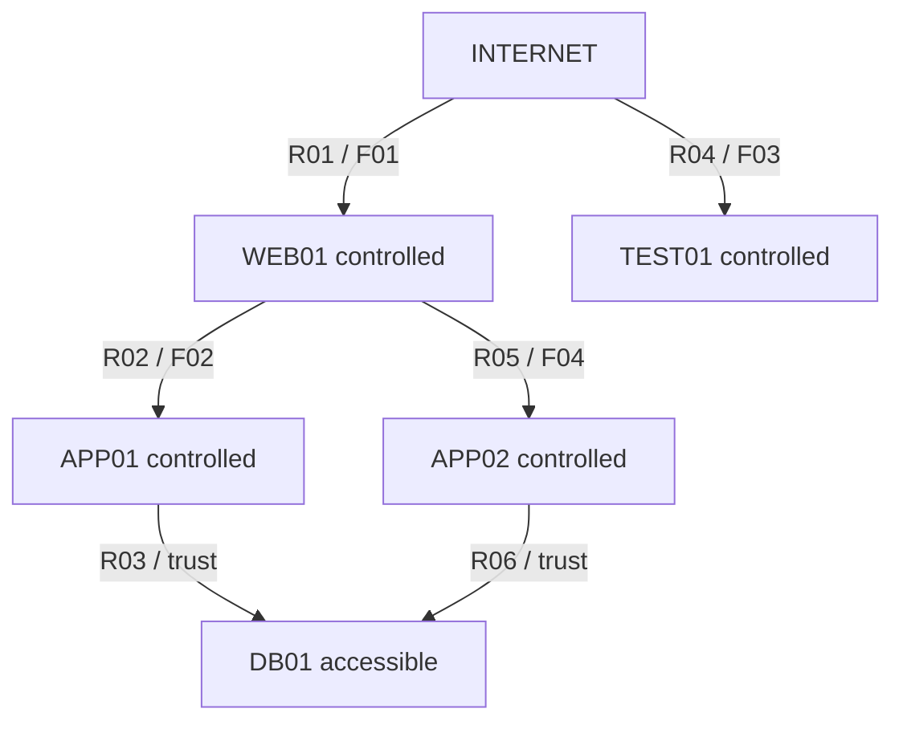

# Threat Model — SV3 và kịch bản diamond-v1

| Thuộc tính | Giá trị |
|---|---|
| Người phụ trách | Trần Gia Bảo — SV3; phối hợp SV1/SV2/SV4 |
| Phiên bản / ngày | 1.0.0 / 2026-10-18 |
| Checklist | Tuần 1 — Ngày 2 |
| Trạng thái | Thiết kế để review; giả định lab chưa là bằng chứng exploit thực tế |

## 1. Mục tiêu và phạm vi

Căn cứ PDF mục 1–6, 8, 11 và 14; bộ chuẩn hóa v2; dataset/config `diamond-v1`.
Tài liệu mô tả hai lớp: (a) attacker trong mạng được phân tích, (b) nguy cơ làm sai
kết quả của chính pipeline phân tích. SV2 xác minh khả thi graph; SV3 dùng các đường
được cung cấp để tính risk/RI, không kiểm chứng exploit bằng tự động khai thác.

Tài sản đích là DB01 và dữ liệu nhạy cảm. Trong fixture, trạng thái đích là
`accessible`, chưa phải bằng chứng attacker đã đọc hoặc lấy cắp dữ liệu.

## 2. Tài sản, dịch vụ và điều chưa biết

| Asset | Vai trò khai báo | Internet-facing | Criticality | Sensitive data | Dịch vụ khai báo |
|---|---|---|---:|---|---|
| WEB01 | Web | true | 3/5 | false | TCP/443 |
| APP01 | Application | false | 4/5 | false | TCP/443 |
| APP02 | Application | false | 4/5 | false | TCP/443 |
| DB01 | Database/target | false | 5/5 | true | TCP/5432 |
| TEST01 | Test/nhánh đối chiếu | true | 1/5 | false | TCP/443 |

Đây là giá trị synthetic được khai báo, không tự suy sản phẩm/phiên bản từ port.
Tên sản phẩm, phiên bản, subnet thực và VLAN ID chưa có trong fixture; không gán
ngầm bằng kiến thức chung về port. Các vùng Web/App/DB dưới đây là trust boundaries
logic để thiết kế, chưa phải bằng chứng firewall/VLAN đã triển khai trong lab thật.

## 3. Attacker và entry point

- Attacker ngoài hệ thống bắt đầu tại ID special `INTERNET`, trạng thái `external`.
- Mục tiêu: đạt `accessible` tại DB01 thông qua các bước exploit/trust được khai báo.
- Ban đầu không có quyền kiểm soát Web/App/DB; chỉ chuyển trạng thái nếu rule đủ điều kiện.
- INTERNET không là một asset inventory. Hệ thống còn hỗ trợ asset đã bị kiểm soát
  làm entry ở kịch bản khác; không ngầm dùng giả định đó trong diamond-v1.
- Không thực hiện auto exploitation hoặc patch production trong scope này.

## 4. Trust boundaries và reachability

| Boundary/connection | Điều kiện được mô hình hóa |
|---|---|
| Internet → Web | C01 cho phép tới service Web; vẫn cần R01/F01 để kiểm soát |
| Web → App01/App02 | C02/C05 cho phép kết nối; cần Web controlled và exploit F02/F04 |
| App01/App02 → DB | C03/C06 và trust rules R03/R06; quyền DB là giả định lab có evidence |
| Internet → Test | C04/R04 tạo nhánh độc lập; không có bước khai báo tới DB |

Không tự sinh chiều ngược. Không coi same subnet, port mở hoặc một CVE có PoC công
khai là đủ để khai thác trong môi trường cụ thể. Credentials/quyền thực cần evidence
của lab hoặc quản trị viên trước khi dùng cho graph thật.

## 5. Rules R01–R06

Semantics reference v1: `required_state` kiểm trên source; `resulting_state` áp vào target.

| Rule | Source → target | Điều kiện source | Phụ thuộc finding | Loại | Kết quả target |
|---|---|---|---|---|---|
| R01 | INTERNET → WEB01 | external | F01 / DEMO-A | exploit | controlled |
| R02 | WEB01 → APP01 | controlled | F02 / DEMO-B | exploit | controlled |
| R03 | APP01 → DB01 | controlled | Không có | trust | accessible |
| R04 | INTERNET → TEST01 | external | F03 / DEMO-C | exploit | controlled |
| R05 | WEB01 → APP02 | controlled | F04 / DEMO-D | exploit | controlled |
| R06 | APP02 → DB01 | controlled | Không có | trust | accessible |

DEMO-A/B/C/D là định danh thử nghiệm, không CVE thật. Chưa có mô tả lỗi kỹ thuật
authoritative; không gọi chúng là RCE, SQL injection hoặc credential theft khi chưa có nguồn.
R03/R06 không có finding vì mô tả quyền truy cập/tin cậy giả định, không khẳng định DB có CVE.

## 6. Đường tấn công khả thi trong fixture

- Path A: R01 → R02 → R03, phụ thuộc F01 và F02.
- Path B: R01 → R05 → R06, phụ thuộc F01 và F04.
- Nhánh R04/F03 không tới DB01 theo graph đã khai báo; không có nghĩa TEST01 an toàn.
- F01 là điểm chung của hai path. Vá F01 loại hai bước đầu vào tương ứng của các path;
  vá F02 vẫn để lại path B, vá F04 vẫn để lại path A.

## 7. Assumptions và giới hạn

| ID | Giả định/giới hạn | Ảnh hưởng |
|---|---|---|
| A01 | Connections/rules/evidence do lab khai báo | Chưa chứng minh exploit thật hoặc dữ liệu sản phẩm đúng |
| A02 | Graph model chỉ loại exploit step khi vá | Không bao phủ side effect, port mới hoặc thay trust sau patch |
| A03 | Trust steps multiplier=1 trong risk model | Lựa chọn heuristic cần audit quyền và sensitivity |
| A04 | Tập targets và model/config cố định khi so trước/sau | Không so hai số risk khác phạm vi như cùng thang |
| A05 | Search phải đầy đủ theo giới hạn/model đã công bố | Budget chưa đủ phải báo lỗi, không kết luận không còn đường |
| A06 | Giá trị CVSS/EPSS/KEV và criticality đều synthetic | Kết quả chỉ dùng kiểm thử model, chưa hiệu quả thực địa |
| A07 | Max-product và strongest-path aggregation | Chặn một path yếu có thể RI=0; không là xác suất thực |
| A08 | DB accessible làm trạng thái đích | Không tự khẳng định đã exfiltrate hay mất dữ liệu |

## 8. Đe dọa tới chính hệ thống phân tích

| Threat | Hậu quả | Kiểm soát/owner |
|---|---|---|
| Input giả mạo, orphan, sửa criticality | Ranking sai | Shared validation, provenance, snapshot hash; SV1/SV3 |
| Rule/trust không có evidence | Sinh path giả | Preconditions/evidence/model review; SV2 |
| Graph bị cắt nhưng báo complete | RI/ranking sai | Budget/completeness tests; SV2; SV3 từ chối incomplete |
| Trộn analysis/details/graph khác lần chạy | Giải thích sai kết quả | IDs/config/dataset/graph hashes và cache checks; SV3/SV4 |
| Mô tả scanner chứa prompt injection | LLM làm theo dữ liệu như instruction | Facts separation, hạn chế tools, validate output; SV4 |
| LLM tự đổi số/tie hoặc bịa CVE | Quyết định không truy vết được | Engine là nguồn số, numeric/ID checks, fallback; SV4 |
| Mutation trong simulation | Các ứng viên không còn cùng trạng thái | Copy/immutability/mutation tests; SV2/SV3 |
| API đọc snapshot không đúng quyền | Lộ dữ liệu topology/finding | Authorization, secret/log filtering khi triển khai; SV4 |

Các kiểm soát là yêu cầu thiết kế; chỉ đánh đã triển khai khi có code/test/evidence tương ứng.

## 9. Checklist review ngày 2

- [ ] Hào xác nhận asset/service/source metadata và trường chưa biết.
- [ ] Huy xác nhận rule/state, connections, path completeness và giới hạn abstraction.
- [ ] Bảo xác nhận target semantics, assumptions risk và before/after scope.
- [ ] Hưng xác nhận cách hiển thị assumptions, incomplete và facts cho LLM.
- [ ] Ghi reviewer/PR và assumptions còn mở; không thay review bằng log unit test.
